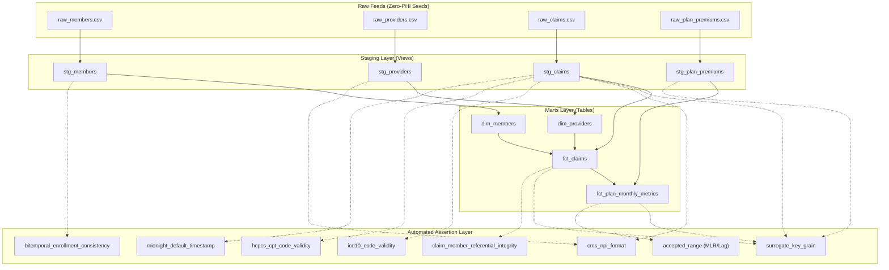

# Architecture - refhealth-starter-dbt-project

System design reference for the production healthcare dbt starter project.

## System Overview

`refhealth-starter-dbt-project` is a reference implementation of the **Governed Data Foundation (Layer 2)** defined in the [Healthcare Data AI Operating System (HDAIOS) v1.0](https://refhealth.consulting/hdaios).

The project solves the five major architectural failure modes common in health-tech analytics engineering:
1. Primary key grain collapse in multi-line claim feeds.
2. Bitemporal desync between enrollment effective dates and encounter service dates.
3. Timestamp precision loss from upstream EDI clearinghouses.
4. Formatting defects in CMS provider registries (NPI) and coding nomenclatures (ICD-10, HCPCS/CPT).
5. Referential integrity failures where claims orphaned from active member enrollment spans reach downstream reporting or AI feature stores.

## Layered Component Architecture

## Key Technical Decisions

### 1. Embedded DuckDB for Instant Zero-Setup Local Execution
- **Rationale**: Analytics engineers and evaluators should not need cloud warehouse credentials or Docker containers to test healthcare dbt models. DuckDB runs embedded, loads CSV seeds instantly, executes transformations in milliseconds, and strictly validates ANSI SQL syntax.
- **Portability**: Transformations use standard ANSI SQL and `dbt_utils` cross-database macros, ensuring drop-in compatibility when pointing `profiles.yml` to Snowflake, BigQuery, Databricks, or PostgreSQL.

### 2. Deterministic Surrogate Key Generation
- Claims line grain requires compound keys (`claim_id`, `claim_line_number`).
- Handled via `dbt_utils.generate_surrogate_key(['claim_id', 'claim_line_number'])` in `stg_claims` to produce a deterministic hash that resists upstream sequence re-numbering.

### 3. Native Adapter Dispatch in Test Assertions
- Regex functions differ across database engines (`regexp_matches` in DuckDB, `regexp_like` in Snowflake, `regexp_contains` in BigQuery, `~` in Postgres).
- Test macros from `refhealth-dbt-healthcare-checks` implement `adapter.dispatch('regexp_match', ...)` to guarantee cross-warehouse test execution without changing model code.

### 4. Zero-PHI Constraint
- All seed datasets contain strictly synthetic names, randomized dates, validly formed but non-identifiable NPIs, and standard clinical codes.
- No protected health information (PHI) or proprietary client data is present.
