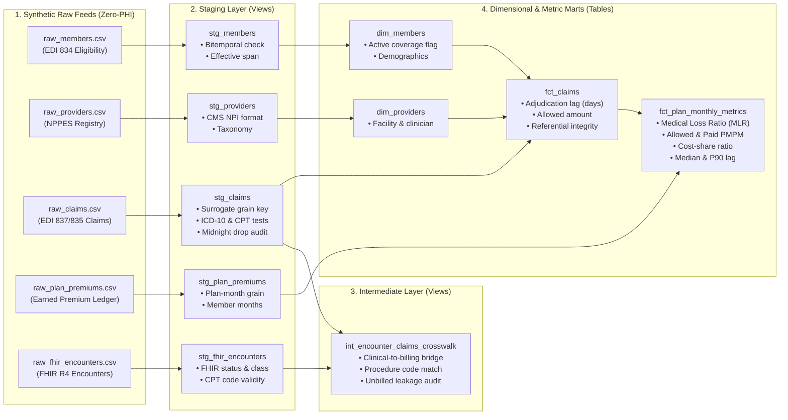

# Production Healthcare dbt Starter Project

[](https://github.com/apratsunrthd/refhealth-starter-dbt-project/actions/workflows/ci.yml)
[](LICENSE)
[](https://www.getdbt.com/)
[](https://github.com/apratsunrthd/refhealth-dbt-healthcare-checks)

A production-grade, cloneable [dbt](https://www.getdbt.com/) starter repository designed specifically for healthcare analytics engineering, health-tech startups, and clinical AI data foundations. 

Maintained by [ref(health) Consulting](https://refhealth.consulting) to demonstrate the **Governed Data Foundation (Layer 2)** of the [Healthcare Data AI Operating System (HDAIOS)](https://refhealth.consulting/hdaios).

---

## Why Healthcare dbt Is Different

Standard e-commerce analytics models fail under real healthcare operating conditions:
1. **Claims Lag & Latency:** Clearinghouse batching introduces multi-week delays between the Date of Service and Claim Payment.
2. **Compound Surrogate Grain:** Claims primary keys are compound (`claim_id`, `claim_line_number`, sub-line counters). Missing sub-grain causes silent row multiplication that artificially inflates Medical Loss Ratios (MLR).
3. **Bitemporal Eligibility Churn:** Member eligibility rosters (EDI 834) churn constantly with retroactive enrollment and termination dates.
4. **Timestamp Precision Drops:** Upstream clearinghouses frequently drop time precision, defaulting times to `00:00:00` and skewing turnaround calculations.
5. **Regulatory Registries:** Healthcare codes (CMS NPI, ICD-10-CM, HCPCS/CPT) must adhere strictly to CMS formats and annual release schedules.

This starter kit implements and tests all five operational realities out of the box using **100% synthetic, zero-PHI data**.

---

## 30-Second Quickstart

This template runs locally on **DuckDB** with zero external database setup, and is fully portable to Snowflake, BigQuery, Databricks, and PostgreSQL.

### 1. Clone & Setup

```bash
git clone https://github.com/apratsunrthd/refhealth-starter-dbt-project.git
cd refhealth-starter-dbt-project

# Install dbt with DuckDB adapter (via pip or uv)
pip install dbt-duckdb
# or: uv run --with dbt-duckdb dbt ...
```

### 2. Install Packages

```bash
dbt deps
```

### 3. Build & Test Everything

```bash
dbt build --profiles-dir .
```

You will see seeds loaded, staging views materialized, intermediate crosswalks and marts created, and **106/106 automated healthcare data tests pass**.

---

## Architecture & Data Flow



---

## Included Models

### Staging Layer (`models/staging/`)
- [`stg_members.sql`](models/staging/stg_members.sql): Normalizes member eligibility dates (`coverage_effective_date`, `coverage_term_date`, `enrollment_date`, `updated_date`).
- [`stg_providers.sql`](models/staging/stg_providers.sql): Cleans National Provider Identifiers (NPI) and taxonomy designations.
- [`stg_claims.sql`](models/staging/stg_claims.sql): Constructs deterministic composite surrogate key `claim_line_surrogate_id` at `(claim_id, claim_line_number)` grain using `dbt_utils.generate_surrogate_key`.
- [`stg_plan_premiums.sql`](models/staging/stg_plan_premiums.sql): Normalizes earned premium revenues and enrolled member months at `(plan_id, service_month)` grain.
- [`stg_fhir_encounters.sql`](models/staging/stg_fhir_encounters.sql): Normalizes HL7 FHIR R4 Encounter resources (`status`, `class_code`, `type_code`, timestamps) and computes surrogate keys at the `encounter_id` grain.

### Intermediate Layer (`models/intermediate/`)
- [`int_encounter_claims_crosswalk.sql`](models/intermediate/int_encounter_claims_crosswalk.sql): Clinical-to-billing crosswalk bridging FHIR EHR encounters to adjudicated EDI 837 claim lines. Computes procedure match flags, encounter-to-paid adjudication turnaround lag, and identifies unbilled clinical activity.

### Marts Layer (`models/marts/`)
- [`dim_members.sql`](models/marts/dim_members.sql): Member dimension calculating current active enrollment status based on bitemporal date spans.
- [`dim_providers.sql`](models/marts/dim_providers.sql): Provider dimension containing rendering clinician and billing organization attributes.
- [`fct_claims.sql`](models/marts/fct_claims.sql): Adjudicated claims fact table joining member and provider dimensions, computing adjudication turnaround lag (`paid_date - date_of_service`) and total allowed amounts.
- [`fct_plan_monthly_metrics.sql`](models/marts/fct_plan_monthly_metrics.sql): Monthly actuarial and financial mart computing statutory Medical Loss Ratio (MLR), Allowed PMPM, Net Paid PMPM, Member Cost-Share Ratio, and Median/P90 claims adjudication turnaround lag.

---

## Automated Healthcare Integrity Tests

This project integrates [`refhealth-dbt-healthcare-checks`](https://github.com/apratsunrthd/refhealth-dbt-healthcare-checks) and `dbt_utils` to enforce domain assertions:

| Test Macro | Location | Operational Risk Prevented |
| :--- | :--- | :--- |
| `surrogate_key_grain` | `stg_claims`, `stg_fhir_encounters`, `stg_plan_premiums`, `int_encounter_claims_crosswalk`, `fct_claims`, `fct_plan_monthly_metrics` | Catches missing sub-line grains before claim row multiplication corrupts MLR. |
| `bitemporal_enrollment_consistency` | `stg_members` | Detects effective dates after termination dates or enrollment dates after update dates. |
| `cms_npi_format` | `stg_providers`, `stg_claims`, `stg_fhir_encounters` | Flags invalid NPI lengths, non-numeric characters, or invalid prefix digits (must start with 1 or 2). |
| `icd10_code_validity` | `stg_claims` | Validates ICD-10-CM alphanumeric format (formatted or unformatted). |
| `hcpcs_cpt_code_validity` | `stg_claims`, `stg_fhir_encounters` | Enforces CPT Category I/II/III and HCPCS Level II code syntax. |
| `midnight_default_timestamp` | `stg_claims` | Detects source feeds dropping timestamp precision and defaulting to `00:00:00`. |
| `claim_member_referential_integrity` | `fct_claims` | Asserts that every claim's date of service falls within the member's active coverage span. |
| `accepted_range` | `fct_plan_monthly_metrics` | Validates statutory MLR bounds (0.50 to 1.50), cost-share ratio (0.0 to 1.0), and non-negative adjudication lag (>= 0 days). |

---

## Adapting to Your Cloud Data Warehouse

To run this project on Snowflake, BigQuery, Databricks, or Postgres:

1. Update `profiles.yml` (see [`profiles.yml.example`](profiles.yml.example)).
2. In `dbt_project.yml`, replace the seed sources with your production raw sources:
   ```yaml
   sources:
     - name: raw_claims
       tables:
         - name: in_network_claims
   ```
3. Run `dbt build`. The test macros in `refhealth-dbt-healthcare-checks` use native adapter dispatch and automatically run the appropriate SQL dialect for your target warehouse.

---

## Related Resources & Standards

- **[ref(health) Consulting](https://refhealth.consulting):** Healthcare data strategy, dbt analytics engineering, and AI operating systems.
- **[Interactive Claims Lag & Capital Float Calculator](https://refhealth.consulting/dbt-consulting.html#calculator):** Real-time client-side calculator measuring unadjudicated float drag, rework friction, and MLR volatility margin.
- **[EDI 837 vs 835 Claims Modeling Guide](https://refhealth.consulting/blog-edi-837-835-claims-modeling-dbt.html):** Architectural breakdown of CAS segment row explosion, reversal accounting, and accurate denial rate modeling.
- **[HDAIOS v1.0 Specification](https://refhealth.consulting/hdaios):** Canonical 5-layer architecture connecting business decisions, governed bitemporal data, enterprise BAAs, and agent orchestration.
- **[Interactive HDAIOS Self-Assessment](https://refhealth.consulting/hdaios.html#assessment):** Free, zero-PHI 10-question evaluation tool calculating your architecture's readiness score.
- **[The 48-Hour Healthcare dbt Audit Playbook](https://refhealth.consulting/blog-healthcare-dbt-audit-playbook.html):** In-depth technical teardown of claims lag, bitemporal desync, and timestamp anomalies.
- **[refhealth-dbt-healthcare-checks](https://github.com/apratsunrthd/refhealth-dbt-healthcare-checks):** Open-source generic dbt testing package.

---

## License

MIT © [ref(health) Consulting](https://refhealth.consulting)
